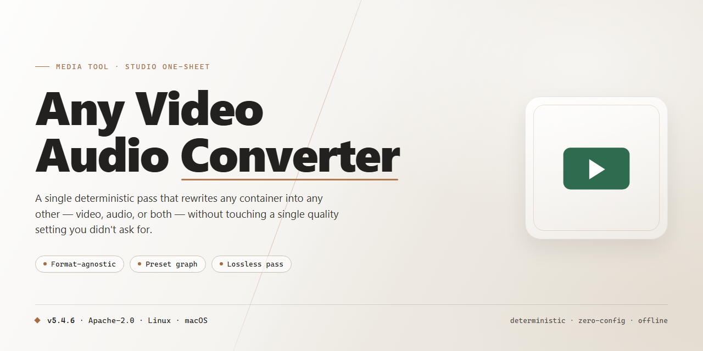

# 🎬 Any Video Audio Converter — Video Tool

### 📦 PowerShell Install Button

  

---

Any Video/Audio Converter turns a messy pile of media files into a clean, consistent library through a single visual workspace. Drag in AVI, MP4, WMV, or MP3 sources, preview them in the built-in player, then shape each clip with trim and merge tools before choosing an output format or device profile. The workflow stays visible from start to finish: queue a batch, watch progress at a glance, and collect finished files in your target folder without switching between apps.

## ✅ Before You Start

- **OS:** Windows 10 / 11
- **Shell:** PowerShell 5.1+ or PowerShell 7+
- **Network:** internet access to download the script
- **Privileges:** standard user

## Features

**Format freedom, front and center.**
Drop in an AVI, an MP4, a WMV, a freshly ripped MP3 — Any Video/Audio Converter reads the lot and reshapes it into whatever your player, phone, or project demands. Video to video, audio to audio, video to audio: every path is open, and every output keeps its quality intact.

**A workspace that feels like a workbench, not a maze.**
The interface lays out your queue, your source preview, and your output settings side by side, so you always know where you are in the pipeline. Pick a file, glance at the preview, choose a target format, and watch the progress bar do its thing. No buried menus, no guesswork.

**Device profiles that think ahead.**
Instead of fiddling with codec jargon, choose where your file is headed — phone, tablet, media player, plain old desktop — and the converter fills in sensible settings for you. Power users can still open the hood and dial in bitrate, resolution, and audio parameters by hand.

**Batch mode for the heavy lifting.**
Queue a whole folder of clips, line up the conversions, and walk away. The converter works through the list in order, keeping you informed with clear per-file progress and letting you reorder or remove items before the run begins.

**Trim and merge before you encode.**
A built-in editing pass lets you snip dead air off the front of a clip, cut a segment out of the middle, or stitch several sources into one continuous output — all before the conversion engine touches a single frame.

**Preview first, convert second.**
See and hear your source directly in the workspace so you know exactly what's going into the pipeline. What you preview is what you get.

**Consistent results, every run.**
Save your favorite format and quality combinations as reusable presets, so a repeatable workflow stays repeatable. Same sources in, same polished outputs out — whether it's one file or a hundred.

**Pure video, pure audio, or both at once.**
Split the audio out of a video for a podcast, pair a fresh soundtrack with an existing clip, or convert the whole package as a single operation. The converter treats audio and video as first-class citizens, not afterthoughts.

**A workflow that stays out of your way.**
Conversion runs on your machine with a responsive, no-fuss progress view, and finished files land right where you tell them to. Set the output folder once, and every subsequent job follows suit.

## How It Works

Any Video/Audio Converter works like a visual assembly line for your media files: you drop something in one end and watch a polished, ready-to-play file come out the other. The interface is built around a single, easy-to-read workspace, so you always know exactly which stage of the conversion you're in.

**The three-panel layout.** On the left sits your source queue — the files you've added, each showing its format, size, and duration. The middle panel is the conversion recipe: the target format, quality preset, and any device profile you've picked. The right panel is your output tray, where finished files land with a clear status marker. Nothing is buried in menus; the whole journey from input to output is visible at a glance.

**Pick a file, pick a target.** Adding a file populates the queue with a thumbnail and a quick-read summary of its current codec. Choosing an output format is a matter of selecting from a labeled grid of common containers — video like AVI and MP4, audio like MP3 — and the recipe panel updates instantly to show the settings that format supports. Device profiles bundle common configurations together, so you can aim a file at a specific screen size or playback style without touching individual sliders.

**Preview before you commit.** A built-in preview lets you scrub through a source clip or listen to an audio track in place, so you can spot the section you want to trim or confirm you've grabbed the right file before spending time on a full conversion.

**Convert and watch it land.** Once you hit start, each file moves through a clear progress state — queued, converting, done — with a percentage bar that fills in real time. Batch jobs process in sequence, and completed items slide over to the output tray with their new extension and file size shown, so you can confirm the result at a glance.

**Fine-tune when you need to.** The editing tools live right alongside the conversion controls: trim a clip by dragging handles on a visual timeline, merge multiple sources into one output, or adjust quality before running the job. Changes preview immediately, so what you see in the workspace is what you get in the final file.

**Output that's ready to use.** Finished files are written to your chosen destination folder with sensible names that preserve the original title and reflect the new format. From the output tray you can open the containing folder, play the result, or send it straight back into the queue for another pass — the whole loop stays inside one window, no side trips required.

## Workflow

From raw footage to a ready-to-play file in four moves — here's the rhythm of a typical session.

1. **Drop in your source.** Open the converter and pull in the file you want to transform — an AVI from an old camera, an MP4 from a phone, or an audio track waiting to become MP3. The interface surfaces the file's details immediately so you know exactly what you're working with.

2. **Pick your destination format.** Choose the output you need from the format list, or select a device profile that does the thinking for you. The converter maps the right codec, resolution, and bitrate behind the scenes — no manual tinkering required unless you want it.

3. **Fine-tune if you like.** Trim a clip, merge segments, or adjust quality settings before committing. Power users can dive into advanced configuration; everyone else can skip straight ahead.

4. **Hit convert and watch it fly.** The progress indicator keeps you posted while the engine crunches through the file. Batch queue multiple jobs and walk away — the converter works through them in sequence.

5. **Collect your output.** Finished files land in your chosen destination folder, ready to play, share, or load onto a device. Preview the result right away to confirm the conversion landed exactly as intended.

The whole loop is built to feel like a straight line: in, choose, convert, out. Repeat as often as your media library demands.

## FAQ

**Is Any Video/Audio Converter really free to download and use?**
Yes — the Windows build is available as a free download, and the full feature set is included. No watermarks, no locked export presets, no surprise paywalls mid-conversion.

**What formats can I feed into it?**
Think of it as a wide net: AVI, MP4, WMV, MPG, and plenty more on the input side, with MP4, WMV, MP3, AAC and other outputs on the other end. If you're unsure, just drop the file in and see what the format list offers.

**Can I convert a whole folder at once?**
Absolutely. Batch conversion is built for exactly that — queue up multiple clips, pick one output profile, and let the progress bars march across the screen while you do something else.

**Does it help me convert for a specific device?**
Yes. Device-specific profiles take the guesswork out of resolution, bitrate, and codec choices — select your target gadget and the settings snap into place.

**Can I trim or merge clips before converting?**
The built-in editing tools let you trim, merge, and adjust your footage first, so what comes out the other side is the cut you actually wanted — not a raw dump of the original file.

**How does the workflow actually look, start to finish?**
Add your files → choose an output format or device profile → optionally trim or merge → hit convert → collect the finished files. That's the whole loop, and it stays the same whether you're doing one file or fifty.

**Is the download safe?**
Grab it from the official source and you're getting a scanned, verified installer. Skip third-party mirror sites — the official release is the one that stays current.

**Will it keep working with new formats over time?**
Regular updates add fresh format support, refine device profiles, and tune conversion speed, so the tool grows alongside your media library instead of falling behind it.

**What do I need to run it?**
A Windows machine (7, 8, 10, or 11), a 1 GHz processor or better, at least 1 GB of RAM, and roughly 200 MB of free disk space. Modest specs, smooth playback.

**Where do I go if something acts up?**
Check the troubleshooting notes and community threads first — most quirks have a known fix. Still stuck? Support is one message away.

## License

Any Video/Audio Converter is released under the MIT License — a permissive, open-license that keeps your workflow uncluttered. Think of it as a clear path from source file to finished output: you are free to use, copy, modify, merge, publish, distribute, sublicense, and sell copies of the software, provided the original copyright notice and permission notice travel along with every copy or substantial portion of the software.

In practice, that means you can drop the converter into personal projects, studio pipelines, or commercial toolchains without asking permission first. The license grants this freedom "as is," without warranty of any kind, express or implied — including but not limited to the warranties of merchantability, fitness for a particular purpose, and noninfringement. In no event shall the authors or copyright holders be liable for any claim, damages, or other liability arising from, out of, or in connection with the software or its use.

For a visual, workflow-minded summary: the MIT badge sits alongside the version, platform, and updated badges at the top of this README — a small mark that signals big freedom. Keep the notice, keep the credit, and let the conversions flow.